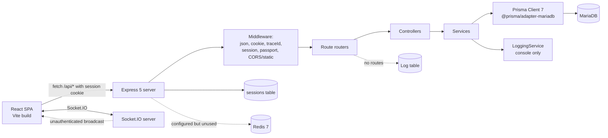
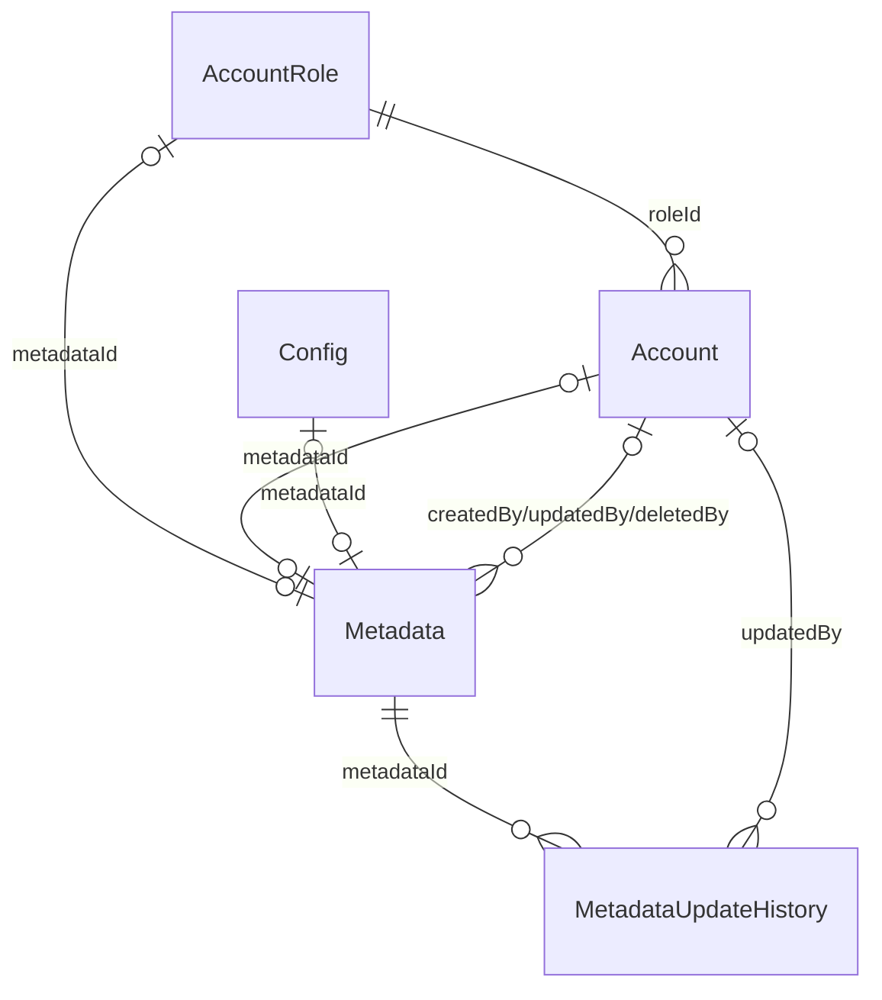
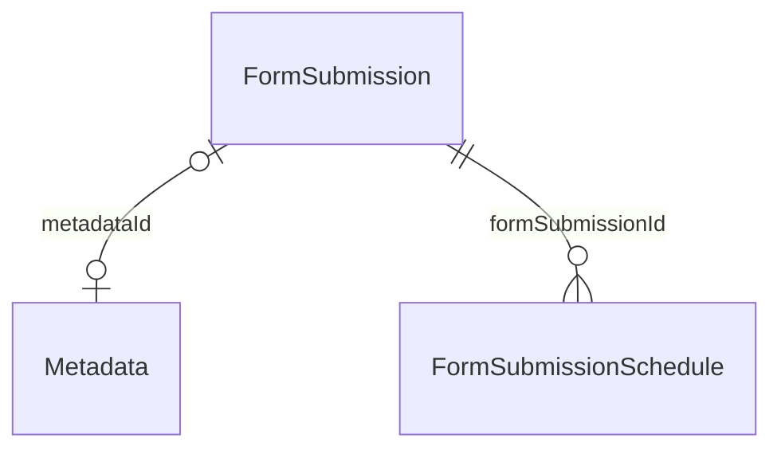

# SUMMARY.md — template-crud-mariadb-rbac

> **Generated:** 2026-10-29
> **Git commit:** `d6ea18dbf7eb7f9a8e536cd1f9c07ba85605fad1`
> **Branch:** `main` (working tree clean; 3 commits total)
> **Audit method:** static reading of all tracked source/config/docs. No `node_modules` present; build/runtime claims are marked **UNVERIFIED** where execution was not possible.

**Section confidence**

| Section | Confidence | Reason |
|---|---|---|
| 1. Project Snapshot | High | Manifests, git history, tree inspected |
| 2. Architecture | High | Entry points and imports traced |
| 3. Data Layer | High | Schema + migration read line-by-line; live DB not inspected |
| 4. Auth & Authorization | High | Middleware, routes, session service traced |
| 5. API / Interface Surface | High | Route files enumerated |
| 6. Configuration & Environments | Medium | Env loading is internally inconsistent; runtime not executed |
| 7. Build, Test & CI | Medium | Scripts read; no dependencies installed, so build outcomes inferred |
| 8. Dependencies | High | Root lockfile resolved versions inspected |
| 9. Code Quality & Technical Debt | High | Static inspection + greps |
| 10. Reuse Potential | Medium | Based on code + license; product intent requires human confirmation |
| 11. Open Questions | High | Derived from concrete contradictions |
| 12. Planning Index | Medium | Feature statuses inferred from code, not product docs |

## Table of Contents

- [1. Project Snapshot](#1-project-snapshot)
- [2. Architecture](#2-architecture)
- [3. Data Layer](#3-data-layer)
- [4. Authentication & Authorization (current state)](#4-authentication--authorization-current-state)
- [5. API / Interface Surface](#5-api--interface-surface)
- [6. Configuration & Environments](#6-configuration--environments)
- [7. Build, Test & CI/CD](#7-build-test--cicd)
- [8. Dependencies](#8-dependencies)
- [9. Code Quality & Technical Debt](#9-code-quality--technical-debt)
- [10. Reuse Potential for a Shared Template](#10-reuse-potential-for-a-shared-template)
- [11. Open Questions & Unknowns](#11-open-questions--unknowns)
- [12. Planning Index](#12-planning-index)

---

# 1. Project Snapshot

**Name:** repository `template-crud-mariadb-rbac`; internal package name `random-system` (`package.json:2`); documentation calls it “Sistema Random” and “Template CRUD + MariaDB + RBAC” (`README.Md:1`, `docs.md:1`).

**Purpose:** A full-stack starter/template for single-tenant admin systems requiring account CRUD, a role/permission (RBAC) model, MariaDB persistence, and an admin web UI. It provides account and account-role management with soft delete/restore, a level-based role hierarchy, session authentication, shared Zod/TypeScript contracts, and a React admin shell. Source: `docs.md:5-9`, `prisma/schema.prisma:10-181`, `server/src/routes/*.ts`, `client/src/routes/admin/*`.

**Maturity: WIP / prototype, not production-ready.** Evidence:

- No tests at all; root `test` is a no-op and server `test` exits 1 (`package.json:20`, `server/package.json:9`). `find` for `*.test.*`, `*.spec.*`, Vitest/Jest configs returned nothing.
- No lint setup: `lint` script exists but ESLint is not a dependency and no ESLint config exists (`package.json:19`).
- Prisma schema and the only migration disagree materially (`prisma/schema.prisma` vs `prisma/migrations/20260512025450_add_form_submission/migration.sql`); details in §3.
- Bootstrap seeds a fixed admin credential and 2FA is declared but not enforced (`server/src/setup.ts:56-69`, `server/src/services/sessions.ts:58-77`).
- Placeholder admin pages (“Página en progreso”) for logs/config (`client/src/routes/admin/logs.tsx:50`, `client/src/routes/admin/config.tsx:50`).
- Logging service never persists anything (`server/src/services/logging.ts:171-200`).
- Only one migration, named `add_form_submission`, which actually creates the whole schema and tables that no longer exist in `schema.prisma`.
- Branding, container names, and package metadata are inherited from other projects (`client/src/layouts/Admin.tsx:206`, `compose.yaml:4,13,26`, `package.json:110`).

**Primary language(s):** TypeScript (server, client, shared), SQL (Prisma migration), YAML (Docker/Drone/MkDocs). Minor JSON/HTML/CSS.

**Frameworks / runtime / package manager:**

| Area | Stack | Evidence |
|---|---|---|
| Backend | Node.js, Express `5.1.0`, Passport `0.7.0` (local strategy), `express-session` `1.19.0`, Socket.IO `4.8.1` | `package.json:26-75`; resolved versions from `package-lock.json` |
| ORM/DB | Prisma Client `7.4.1`, `@prisma/adapter-mariadb` `7.4.1`, MariaDB | `prisma/schema.prisma:1-8`, `server/src/config/prisma.ts:1-34` |
| Frontend | React `19.2.0`, Vite `7.3.2`, TanStack Router `1.132.47`, Ant Design `5.27.6`, Redux Toolkit `2.9.1`, Tailwind CSS `4` | `package.json:31-74`, `client/vite.config.ts`, `client/src/App.tsx` |
| Validation | Zod `4.1.12` | `shared/schemas/*.ts` |
| Runtime version | Docker `node:20-alpine`; local audited machine Node `v24.19.0`, npm `12.2.0` | `Dockerfile:1`; `node -v` |
| Package manager | npm workspaces at root (`client`, `server`, `shared`) | `package.json:6-10`; docs incorrectly say `pnpm` (`docs/prisma.md:11`, `docs/client.md:18`) |

**Repo layout:** Single monorepo, npm workspaces. Effectively three code areas plus root Prisma/docs:

| Path | Role |
|---|---|
| `server/` | Express API (src only; almost all deps hoisted to root) |
| `client/` | React SPA (src only; all deps hoisted to root) |
| `shared/` | Type-only contracts, Zod schemas, permission constants (no `package.json`, no build) |
| `prisma/` | Schema + one migration |
| `docs/`, `docs.md` | MkDocs documentation (partly inaccurate/aspirational) |
| Root | `Dockerfile`, `compose.yaml`, `.drone.yml`, `prisma.config.ts`, workspace manifest |

**Last significant activity:** `d6ea18d` on 2026-07-09 (“a”); previous commits `804674c` 2026-06-15 (“some docs”) and `5d9f603` 2026-06-15 (“Uploaded”). History appears squashed/imported (3 commits total). **Contributors:** 2 identities — Fernando Rivera (2 commits) and Asterki (1 commit), per `git shortlog -sn --all`.

---

# 2. Architecture

**Scope:** A single deployable Node server that serves both the JSON API and the built React SPA in production. No separate BFF, worker, queue, or microservice exists.

## 2.1 Component diagram



Sources: `server/src/index.ts:19-61`, `server/src/routes/index.ts:8-12`, `server/src/services/sessions.ts:16-31`, `server/src/services/logging.ts:171-200`, `server/src/services/socket.ts:28-35`, `compose.yaml:2-9`.

## 2.2 Entry points and request lifecycle

**Backend entry point:** `server/src/index.ts:19` (`startServer`), invoked at `server/src/index.ts:63`. Build output path is `server/dist/server/src/index.js` (`server/package.json:11`, `server/tsconfig.json` rootDir `../`).

Order of middleware and startup:

1. `loadEnv()` reads `.env.dev`/`.env.prod` and exits on missing required vars (`server/src/config/env.ts:8-31`).
2. Express app + HTTP server created (`server/src/index.ts:25-26`).
3. `express.json({ limit: "50mb" })`, `cookie-parser`, `traceIdMiddleware`, `/uploads` static (`server/src/index.ts:29-32`).
4. If `NODE_ENV !== "production"`: permissive CORS from `ALLOWED_ORIGINS` with credentials. Else: serve `client-dist` and SPA fallback for non-`/api/` GETs (`server/src/index.ts:34-49`).
5. Session middleware + Passport initialize/session (`server/src/index.ts:51-52`, `server/src/services/sessions.ts:92-96`).
6. Routers mounted under `/api/auth`, `/api/accounts`, `/api/account-roles` (`server/src/routes/index.ts:8-12`).
7. Listen on `PORT`, then attach Socket.IO (`server/src/index.ts:54-60`).

**Per-request lifecycle for a protected mutation:**

`POST /api/accounts/create` → `express.json` → cookie/trace → session → Passport deserialize user from DB → `router.use(ensureAuthenticated)` (`server/src/routes/accounts.ts:32`) → `ensurePermissions(["accounts:create"])` (`:37`) → `validateRequestBody(createSchema)` (`:38`) → controller (`server/src/controllers/accounts/create.ts`) → `createAccountWithRetry` service (`server/src/services/accounts/create.ts`) → Prisma → JSON response.

Important: validation writes to `req.parsedBody` (`server/src/middleware/validationMiddleware.ts:31`), but controllers read the raw `req.body` (e.g. `server/src/controllers/accounts/create.ts:19`). Zod defaults/transforms/coercions therefore never reach handlers.

**Client entry point:** `client/index.html:14` → `client/src/main.tsx:6` → `client/src/App.tsx` (Redux Provider + TanStack Router) → generated `client/src/routeTree.gen.ts`. API calls live in `client/src/features/*/api.ts`; auth state in `client/src/features/auth/slice.ts`.

**Bootstrap side effect:** importing `server/src/config/prisma.ts` immediately connects the adapter and runs `setupServer()` in a non-awaited IIFE (`server/src/config/prisma.ts:21-30`). This runs during ESM module evaluation, before `startServer()` calls `loadEnv()`. The HTTP listener does not wait for DB connect/seed.

## 2.3 Module / directory map

| Path | Responsibility | Key files | Depends on |
|---|---|---|---|
| `server/src/index.ts` | App composition, middleware, listener, Socket.IO attach | `index.ts` | config, routes, sessions, socket |
| `server/src/config/` | Env loading, Prisma adapter/client + bootstrap, unused Redis client | `env.ts`, `prisma.ts`, `redis.ts` | dotenv, Prisma adapter, setup |
| `server/src/routes/` | Express routers, auth/permission/validation chains | `auth.ts`, `accounts.ts`, `account-roles.ts`, `index.ts` | controllers, middleware, shared schemas |
| `server/src/controllers/` | HTTP status mapping, input extraction, orchestration | `auth/*`, `accounts/*`, `account-roles/*` | services, Prisma, logging, shared API types |
| `server/src/services/` | Business logic, retries, soft delete, session store, socket, logging | `accounts/*`, `account-roles/*`, `sessions.ts`, `logging.ts`, `socket.ts` | Prisma, async-retry, bcrypt, passport |
| `server/src/middleware/` | Auth, RBAC, trace ID, Zod validation, no-op sanitizer | `authMiddleware.ts`, `traceId.ts`, `validationMiddleware.ts`, `sanitizeBody.ts` | shared types |
| `server/src/utils/` | Password/session mapping, dynamic Prisma select builders, permission helper | `accounts.ts`, `prisma.ts`, `permissions.ts` | bcrypt, Prisma types |
| `server/src/errors/` | Generic `APIError` | `api.ts` | — |
| `server/src/types/` | Express request augmentation, `AccountWithRole` | `index.ts` | Prisma types |
| `server/src/setup.ts` | Fresh-database bootstrap (Admin role + admin account) | `setup.ts` | Prisma, account service |
| `shared/schemas/` | Zod request schemas + field enums | `accounts.ts`, `account-roles.ts`, `auth.ts`, `logs.ts`, `files.ts`, `index.ts` | zod |
| `shared/api/` | Request/response TypeScript contracts | `accounts.ts`, `account-roles.ts`, `auth.ts`, `index.ts` | zod, Prisma generated types |
| `shared/types/`, `shared/models/`, `shared/constants/` | Session/domain types, legacy model shapes, permission catalog | `sessions.d.ts`, `permissions.d.ts`, `permissions.ts`, `models/*.d.ts` | — |
| `client/src/routes/` | File-based pages (admin/auth/errors) | `admin/*`, `auth/*`, `errors/*`, `__root.tsx`, `index.tsx` | features, layouts |
| `client/src/features/` | Feature modules: API client, Redux slice, hooks, components | `auth/*`, `accounts/*`, `roles/*` | shared contracts, axios, antd |
| `client/src/layouts/` | Admin shell (sidebar) and public shell | `Admin.tsx`, `General.tsx` | auth state, permissions util |
| `client/src/locales/` | Spanish translation catalog | `es.ts` | — |
| `prisma/` | Schema and migration | `schema.prisma`, `migrations/*` | — |
| Root | Build/deploy/docs | `package.json`, `Dockerfile`, `compose.yaml`, `.drone.yml`, `prisma.config.ts` | — |

## 2.4 Key design patterns and conventions

- **Layered controller/service**, one file per action (`controllers/accounts/create.ts`, `services/accounts/create.ts`). Controllers own HTTP status; services own Prisma calls.
- **Retry wrapper pattern:** every service exposes `xxxWithRetry` using `async-retry` with `{ retries: 3, minTimeout: 1000, maxTimeout: 5000, factor: 2 }` (e.g. `server/src/services/accounts/create.ts:116-151`).
- **Metadata-based soft delete + audit history:** `Metadata.deleted/deletedAt/deletedBy` and `MetadataUpdateHistory.changes` JSON (`prisma/schema.prisma:81-123`). Delete/restore are updates, not SQL deletes.
- **Level-based RBAC:** lower integer = more privilege; `-1` is the seeded system admin; role `permissions` is a comma-separated string, with `"*"` wildcard (`server/src/setup.ts:26-33`, `server/src/middleware/authMiddleware.ts:20-27`).
- **Shared Zod schemas + inferred TS contracts** in `shared/`; server validates and client pre-validates the same schemas (`shared/schemas/*`, `client/src/routes/auth/login.tsx:44-50`).
- **Dynamic Prisma select/populate builders** driven by validated field arrays (`server/src/utils/prisma.ts:16-101`; schemas enumerate allowed fields).
- **Singletons:** `SessionManager` self-instantiation (`server/src/services/sessions.ts:14,87-90`) and `SocketServer.getInstance()` (`server/src/services/socket.ts:23-26`).
- **Trace IDs:** UUID per request, returned as `x-trace-id` and stored on `req.traceId` (`server/src/middleware/traceId.ts:4-13`).
- **Error handling convention:** custom error classes (`APIError`, `EmailInUseError`, `AccountNotFoundError`, `CannotUpdateRoleAtThisLevelError`, etc.) caught per-controller; **no global Express error handler** (no `app.use((err,...))` found).
- **Naming:** Prisma models PascalCase; columns camelCase; DB table override only for `sessions` (`prisma/schema.prisma:148`); route segments kebab-case; client features under `src/features/<domain>/{api,hooks,components}`.
- **Logging:** human-readable `console.log` with a structured object; `LoggingService` has no persistence (`server/src/services/logging.ts:171-200`).

---

# 3. Data Layer

**Scope:** All persistence is MariaDB via Prisma. No queues, object storage, or secondary database are active.

## 3.1 Engine, driver, ORM

| Item | Value | Evidence |
|---|---|---|
| Database | MariaDB | `prisma/schema.prisma:6-8`, `@prisma/adapter-mariadb` |
| Version | **UNKNOWN / unpinned** — compose uses `mariadb:latest` | `compose.yaml:12` |
| Prisma datasource provider | `mysql` | `prisma/schema.prisma:6-8` |
| Driver/adapter | `PrismaMariaDb` from `@prisma/adapter-mariadb` `7.4.1` | `server/src/config/prisma.ts:1-19` |
| ORM | Prisma Client `7.4.1`, generated to `node_modules/.prisma/client` | `prisma/schema.prisma:1-4` |
| CLI | `prisma` resolved `7.8.0` in root lock (declared `^7.4.1`) | `package-lock.json`; `package.json:101` |
| Connection string | `DATABASE_URL` (required) | `server/src/config/env.ts:16-21`, `.env.example:2` |

No raw query builder, repository abstraction, or DB transaction helper exists. Services call `prismaClient.<model>.*` directly.

## 3.2 Migrations

- Tool: **Prisma Migrate** (`prisma.config.ts:13-20`), migrations in `prisma/migrations/`, lock provider `mysql` (`prisma/migrations/migration_lock.toml`).
- Only one migration: `prisma/migrations/20260512025450_add_form_submission/migration.sql` (169 lines). It creates the entire schema, despite its name.
- Intended prod command per docs: `npx prisma migrate deploy` (`docs/deployment.md:13`). Actual compose command: `npx prisma db push` (`compose.yaml:41`), which is schema-destructive and bypasses migration history.
- No `prisma.seed` config, no seed script in `package.json`, no fixtures. Bootstrapping is an app side effect (`server/src/config/prisma.ts:21-30` → `server/src/setup.ts:8-70`).

**Critical drift between schema and migration:**

| Area | `prisma/schema.prisma` (generated client source) | Migration SQL | Consequence |
|---|---|---|---|
| Account status | `enum AccountStatus { active, inactive }` (`:29-32`) | `ENUM('active','locked')` (`migration.sql:22`) | `inactive` cannot be written if DB came from migration; login checks `"inactive"` (`sessions.ts:65`) |
| Account campus | **Absent from model** (`:34-68`) | `campus ENUM(...) NOT NULL` (`migration.sql:23`) | Generated client has no `campus`; server/client code uses it (see §9) |
| Form submissions | **Absent** | `FormSubmission`, `FormSubmissionSchedule` created (`migration.sql:112-136,166-169`) | `prisma db push` would drop them; no code uses them |
| Migration name | — | Called `add_form_submission` but creates all tables | Misleading history; no baseline migration |

## 3.3 Table inventory

DB tables below are the union of schema models and migration. PK is always a `VARCHAR(191)` cuid unless noted. MariaDB/InnoDB automatically indexes FK columns; only explicit indexes are listed.

| Table | Purpose | Key columns | PK | FKs | Indexes / constraints | Notes |
|---|---|---|---|---|---|---|
| `AccountRole` | RBAC role definitions | `name`, `description`, `isSystemRole`, `level`, `requiresTwoFactor`, `permissions` TEXT, `metadataId` | `id` | `metadataId → Metadata.id` (SET NULL) | unique `name`, unique `metadataId` | `permissions` comma-separated; no unique constraint on `level` |
| `Account` | Login identities | `email`, `password` (bcrypt), `roleId`, `status`, `name`, `lastLogin`, `emailVerified`, TFA/Forgot tokens, `metadataId` | `id` | `roleId → AccountRole.id` (RESTRICT); `metadataId → Metadata.id` (SET NULL) | unique `email`, unique `metadataId` | `campus` exists only in migration; token fields unused |
| `Metadata` | Shared audit/soft-delete envelope | `createdBy/updatedBy/deletedBy`, `deleted`, `deletedAt`, `status`, `source`, `notes`, `tags`, `documentVersion`, `syncVersion` | `id` | 3 × `Account.id` (SET NULL) | none beyond FK indexes | `tags` is TEXT, not an array |
| `MetadataUpdateHistory` | Per-update change log | `metadataId`, `updatedAt`, `updatedById`, `changes` JSON | `id` | `metadataId → Metadata.id` (CASCADE); `updatedById → Account.id` (SET NULL) | FK indexes | One row per update; stores old/new-ish values |
| `Config` | Intended app config record | `metadataId` | `id` | `metadataId → Metadata.id` (SET NULL) | unique `metadataId` | Model exists; **no routes/services use it** |
| `sessions` | Express session store | `id`, `sid`, `data` TEXT, `expiresAt` | `id` | none | unique `sid` | `@@map("sessions")`; no index on `expiresAt` |
| `Log` | Intended audit/technical log | `date`, `source`, `level`, `message`, `duration`, `details` JSON, `traceId`, `references` JSON | `id` | none | indexes on `date`, `level`, `traceId`, `source` | No writes; no API/UI |
| `FormSubmission` | Migration-only domain table | `locationLat`, `locationLng`, `submittedAt`, `metadataId` | `id` | `metadataId → Metadata.id` (SET NULL) | unique `metadataId`, index `submittedAt` | Not in schema; no code |
| `FormSubmissionSchedule` | Migration-only schedule | `formSubmissionId`, `dayOfWeek` ENUM (Spanish weekdays), `entryTime`, `exitTime` | `id` | `formSubmissionId → FormSubmission.id` (CASCADE) | index FK; unique `(formSubmissionId, dayOfWeek)` | Not in schema; no code |
| `_prisma_migrations` | Prisma bookkeeping | Prisma-managed | — | — | — | Present when using `migrate` |

## 3.4 ER relationships (schema models)



Migration-only, not representable from `schema.prisma`:



## 3.5 Charset, engine, naming

- Charset/collation: every migration table explicitly `DEFAULT CHARACTER SET utf8mb4 COLLATE utf8mb4_unicode_ci` (e.g. `migration.sql:15,40,60,71,80,91,110,123,136`).
- Engine: not specified in DDL. MariaDB default is InnoDB; actual engine is **UNVERIFIED**.
- Naming: PascalCase table names for domain tables, lowercase `sessions`, camelCase columns. Prisma `@default(cuid())` string IDs. No snake_case mapping.
- No `tenant_id`, `tenant`, schema-per-tenant, or database-per-tenant field anywhere (searched all tracked files).

## 3.6 Stored procedures, triggers, views, events, raw SQL

- **None.** No `CREATE PROCEDURE`, `CREATE TRIGGER`, `CREATE VIEW`, or `CREATE EVENT` in the repo.
- Raw SQL exists only in the single Prisma migration (`prisma/migrations/20260512025450_add_form_submission/migration.sql`).
- Logging query code contains leftover Mongo operators (`$regex`, `$gte`, `$lte`) but no SQL (`server/src/services/logging.ts:224-256`).

## 3.7 Seed data and fixtures

- **Auto-seed on boot** (not via Prisma seed): if `Account.count() === 0`, create an `Admin` role at `level: -1`, `permissions: "*"`, `isSystemRole: true`, `requiresTwoFactor: true`, then create one account (`server/src/setup.ts:8-70`).
- Fixed bootstrap email and password are hardcoded in `server/src/setup.ts:56-65`; the password value is **redacted** here. This is a real credential risk, not an example placeholder.
- No fixtures, factories, sample records, or test DB seeds exist. `sample/gps-sim.ts` referenced by `package.json:22` does not exist.

---

# 4. Authentication & Authorization (current state)

**Scope:** Authentication is server-side session cookies via Passport Local; authorization is application-level RBAC only. There is no multi-tenancy and no DB row-level security.

## 4.1 Authentication

| Aspect | Implementation | Evidence |
|---|---|---|
| Mechanism | Cookie session + Passport `local` strategy, not JWT/OAuth/API keys | `server/src/services/sessions.ts:16-83` |
| Identifier | `email` (username field), password | `server/src/services/sessions.ts:37-42` |
| Password hashing | bcrypt, cost 10, synchronous compare on login | `server/src/services/accounts/create.ts:46-47`; `sessions.ts:59` |
| Session store | `PrismaSessionStore` into `sessions` table; prune every 2 min | `server/src/services/sessions.ts:26-30` |
| Session cookie | `secure:false`, `httpOnly:false`, `sameSite:"lax"`, 7-day max age | `server/src/services/sessions.ts:20-25` |
| Cookie signing | `cookie-parser(SESSION_SECRET)` | `server/src/index.ts:30` |
| Serialization | user id → DB reload with role on each request | `server/src/services/sessions.ts:99-115` |
| Login endpoint | `POST /api/auth/login` (public), validates Zod then Passport | `server/src/routes/auth.ts:18`; `controllers/auth/login.ts:12-56` |
| Logout | `req.logOut`, session not destroyed / cookie not explicitly cleared | `server/src/controllers/auth/logout.ts:9-17` |
| Session fetch | `GET /api/auth/fetch` returns `ISessionAccount` with permissions array | `controllers/auth/fetch.ts:6-18`; `utils/accounts.ts:12-36` |
| 2FA | Schema/session/DB fields exist; **login ignores `tfaCode` and `tfaSecret`** | `shared/schemas/auth.ts:11-15`; `sessions.ts:58-77` |
| Email verification / password reset | Columns exist; **no routes/services** | `prisma/schema.prisma:43-57` |
| Login rate limiting / lockout | **None found** | No limiter dependency or middleware in `server/src` |

`requiresTwoFactor` is persisted on roles and editable in the UI (`shared/schemas/account-roles.ts:15`, `client/src/features/roles/components/UpdateModal.tsx:193-199`), but never enforced. The Admin role is seeded with it `true` (`server/src/setup.ts:33`), giving a false sense of 2FA.

## 4.2 Authorization model

| Element | Implementation | Evidence |
|---|---|---|
| Model type | Role-based; one role per account | `prisma/schema.prisma:38-41` |
| Role hierarchy | Integer `level`; lower = stronger; `-1` = system Admin | `setup.ts:29`; `account-roles/create.ts:36-41` |
| Permission storage | Single TEXT column, comma-separated; `"*"` wildcard | `schema.prisma:19`; `authMiddleware.ts:20-27` |
| Permission catalog | Hardcoded union in TS + array constant | `shared/types/permissions.d.ts:1-25`; `shared/constants/permissions.ts:3-41` |
| Check semantics (server) | `ensurePermissions`: requires **all** listed permissions; `"*"` short-circuits | `server/src/middleware/authMiddleware.ts:16-38` |
| Check semantics (client) | `hasPermissions`: returns true if **any** listed permission matches | `client/src/utils/permissions.ts:3-15` |
| Unused helper | `ensureAtLeastOnePermission` exists but no route uses it | `authMiddleware.ts:40-62`; grep |
| Wildcard variants | `"*:*"` is defined but only `"*"` is honored | `shared/constants/permissions.ts:4-5`; `authMiddleware.ts:21` |
| UI gating | Menu items/buttons hidden using `accounts:read`, `account-roles:read`, etc. | `client/src/layouts/Admin.tsx:120-170`; `AccountRolesTable.tsx:81-96` |

**Enforcement map**

| Surface | Auth | Permission check | Evidence |
|---|---|---|---|
| `POST /api/auth/login` | No | No | `routes/auth.ts:18` |
| `POST /api/auth/logout`, `GET /api/auth/fetch` | Yes | No | `routes/auth.ts:19-20` |
| `accounts/create,update,delete,restore,update-password,update-status` | Yes | Yes (specific permission) | `routes/accounts.ts:35-75` |
| `accounts/get`, `accounts/list` | Yes | **No permission check** — any authenticated user can read account data | `routes/accounts.ts:77-79` |
| `account-roles/create,update,delete,restore` | Yes | Yes | `routes/account-roles.ts:34-63` |
| `account-roles/get`, `account-roles/list` | Yes | **No permission check** | `routes/account-roles.ts:66-69` |
| Socket.IO events | **No** | **No** — auth middleware is commented out; `update_coords` broadcasts to all | `server/src/services/socket.ts:28-35,82` |
| `/uploads/*` | No | No | `server/src/index.ts:32` |
| DB layer | — | No RLS, no row scoping, no DB grants in repo | `prisma/schema.prisma` |

**Row-level / hierarchy checks that do exist:**

- Create account: cannot assign a role with `level` lower than the actor's, **but same level is allowed** (`controllers/accounts/create.ts:53-62`).
- Update account role: cannot assign a role at or below actor level (`controllers/accounts/update.ts:41-47`), but the **target account's current role level is not checked** for name/email edits.
- Delete / change password / change status: target role level must be strictly greater (weaker) than actor (`delete.ts:49-61`, `update-password.ts:40-46`, `update-status.ts:39-45`).
- Create role: new level must be greater than actor level; level must be unused (`controllers/account-roles/create.ts:36-63`).
- Update role: cannot move to a lower level; cannot touch a role at actor's level or `-1` (`controllers/account-roles/update.ts:40-89`).
- Delete role: **no level or `isSystemRole` guard** (`controllers/account-roles/delete.ts:22-26`; `services/account-roles/delete.ts:30-60`). Any holder of `account-roles:delete` can soft-delete the Admin role.

## 4.3 Tenancy model

**Single-tenant per deployment.** There is no `tenant_id`, tenant table, per-tenant schema/database logic, or tenant resolution middleware. `DATABASE_URL` points at one database (`prisma/schema.prisma:6-8`). The `campus` field (migration-only) is an organizational attribute, not a security boundary: no query filters or authorization checks by campus (`controllers/accounts/list.ts:42-67`).

## 4.4 MariaDB users, GRANTs, privileges

- No `.sql` GRANT/REVOKE statements anywhere in the repo.
- Compose creates the DB/user from `MYSQL_DATABASE`, `MYSQL_USER`, `MYSQL_PASSWORD`, `MYSQL_ROOT_PASSWORD` (`compose.yaml:15-16`, `.env.example:3-7`). The MariaDB image conventionally grants that user all privileges on that database; exact grants are **UNVERIFIED** (no live DB).
- The app connects with `DATABASE_URL`; no read-only or least-privilege app user is defined in code or docs.

## 4.5 Gaps, risks, inconsistencies

- **Default admin is unrotatable via API.** Seed creates the only `level:-1` account (`setup.ts:56-65`); every password/status/delete check requires target level **strictly greater** than actor (`update-password.ts:40-46`), so the admin (level `-1`) cannot change its own password, and no other account can be at `-1` because role creation requires `level > actor` (`account-roles/create.ts:36-41`). Rotation requires direct DB access.
- **Read endpoints leak directory data.** Any authenticated account can list/get every account (emails, roles, metadata) and every role (including permissions) because `accounts:read` / `account-roles:read` are never enforced server-side.
- **Insecure cookie defaults:** `httpOnly:false` exposes the session cookie to XSS; `secure:false` sends it over HTTP; no session ID regeneration on login; no CSRF token; `sameSite:lax` only partial mitigation.
- **No brute-force protection** on login; `bcrypt.compareSync` blocks the event loop (`sessions.ts:59`).
- **2FA is cosmetic;** `tfaCode` is accepted by validation then ignored.
- **Wildcard mismatch:** `"*:*"` in the catalog is not honored; permissions are substring-free comma split, so whitespace or duplicates are fragile (`authMiddleware.ts:20`).
- **Client/server semantics differ:** client `hasPermissions` uses `some`, server `ensurePermissions` uses `every` (`client/src/utils/permissions.ts:13`; `authMiddleware.ts:25`).
- **System role deletable:** no guard against `isSystemRole` or `level === -1` on delete; UI-only protection.
- **Same-level account creation** allows a manager to create peers with identical privileges (`create.ts:53-62`).
- **No password change for self:** there is no profile endpoint; `cannot-change-own-password` is declared in contracts (`shared/api/accounts.ts:85`) but never produced.
- **Status enum mismatch** (`inactive` vs `locked`) can make deactivation fail at the DB layer.
- **Socket events are unauthenticated** and broadcast arbitrary payloads to all clients (`socket.ts:30-33`).
- **Authorization responses use 401** for role-level failures, and body `{status:"unauthorized"}` while the shared contract defines `"forbidden"` (`shared/api/index.ts:1-7`).

---

# 5. API / Interface Surface

**Scope:** All business endpoints are JSON `POST` actions under `/api/<resource>/<action>`; only auth fetch is `GET`. No versioning, pagination headers, OpenAPI, or webhooks exist.

## 5.1 HTTP API

| Method | Path | Auth required | Permission required | Handler file |
|---|---|---|---|---|
| POST | `/api/auth/login` | No | — | `server/src/controllers/auth/login.ts` |
| POST | `/api/auth/logout` | Yes | — | `server/src/controllers/auth/logout.ts` |
| GET | `/api/auth/fetch` | Yes | — | `server/src/controllers/auth/fetch.ts` |
| POST | `/api/accounts/create` | Yes | `accounts:create` | `controllers/accounts/create.ts` |
| POST | `/api/accounts/update` | Yes | `accounts:update` | `controllers/accounts/update.ts` |
| POST | `/api/accounts/update-status` | Yes | `accounts:update-status` | `controllers/accounts/update-status.ts` |
| POST | `/api/accounts/update-password` | Yes | `accounts:change-password` | `controllers/accounts/update-password.ts` |
| POST | `/api/accounts/delete` | Yes | `accounts:delete` | `controllers/accounts/delete.ts` |
| POST | `/api/accounts/restore` | Yes | `accounts:restore` | `controllers/accounts/restore.ts` |
| POST | `/api/accounts/get` | Yes | **None** (should be `accounts:read`) | `controllers/accounts/get.ts` |
| POST | `/api/accounts/list` | Yes | **None** (should be `accounts:read`) | `controllers/accounts/list.ts` |
| POST | `/api/account-roles/create` | Yes | `account-roles:create` | `controllers/account-roles/create.ts` |
| POST | `/api/account-roles/update` | Yes | `account-roles:update` | `controllers/account-roles/update.ts` |
| POST | `/api/account-roles/delete` | Yes | `account-roles:delete` | `controllers/account-roles/delete.ts` |
| POST | `/api/account-roles/restore` | Yes | `account-roles:restore` | `controllers/account-roles/restore.ts` |
| POST | `/api/account-roles/get` | Yes | **None** (should be `account-roles:read`) | `controllers/account-roles/get.ts` |
| POST | `/api/account-roles/list` | Yes | **None** (should be `account-roles:read`) | `controllers/account-roles/list.ts` |

Route mounting: `server/src/routes/index.ts:8-12`. Body validation schemas: `shared/schemas/accounts.ts`, `shared/schemas/account-roles.ts`, `shared/schemas/auth.ts`.

**Not implemented as routes:** `/api/logs`, `/api/config`, `/api/files`, registration, email verification, password reset, 2FA challenge. The `Log`, `Config`, and file schemas/models exist but are orphaned (`shared/schemas/logs.ts`, `shared/schemas/files.ts`, `prisma/schema.prisma:127-139`).

## 5.2 Socket.IO interface

| Direction | Event | Auth | Payload / behavior | Evidence |
|---|---|---|---|---|
| Client → server | `update_coords` | None | Arbitrary data | `server/src/services/socket.ts:30` |
| Server → all other clients | `coords_updated` | None | Rebroadcast of payload | `server/src/services/socket.ts:32` |

Socket auth middleware is written but commented out (`socket.ts:49-70,82`). Socket CORS uses `CORS_ORIGIN` (not `ALLOWED_ORIGINS`) (`socket.ts:76`), and `CORS_ORIGIN` is not documented in `.env.example`.

## 5.3 UI routes (TanStack file routes)

| Route | Purpose | Client-side auth | Evidence |
|---|---|---|---|
| `/` | Immediate redirect to `/admin` | No | `client/src/routes/index.tsx:10-16` |
| `/auth/login` | Login form + TFA modal shell | No | `client/src/routes/auth/login.tsx:18` |
| `/auth/logout` | Logout confirmation | Fetches session | `client/src/routes/auth/logout.tsx:15` |
| `/admin/` | Dashboard tiles filtered by permissions | Fetch in layout | `client/src/routes/admin/index.tsx:20` |
| `/admin/accounts/` | Account CRUD table + modals | Client checks `accounts:read` | `client/src/routes/admin/accounts/index.tsx:19,119-131` |
| `/admin/accounts/roles` | Role CRUD table + drawer | Client checks `account-roles:read` | `client/src/routes/admin/accounts/roles.tsx:17,95-109` |
| `/admin/config` | Placeholder page | Layout only | `client/src/routes/admin/config.tsx:14` |
| `/admin/logs` | Placeholder page | Layout only | `client/src/routes/admin/logs.tsx:14` |
| `/errors/404` | Not-found page (not wired as router default) | No | `client/src/routes/errors/404.tsx:5`; `App.tsx:12-16` |
| `/errors/offline` | Retry screen | No | `client/src/routes/errors/offline.tsx:11` |

## 5.4 External integrations / webhooks

- **None active.** No webhook endpoints, no outbound HTTP clients besides the browser→API axios client.
- `nodemailer`, `redis`, `socket.io`, `sharp`, `chromadb`, `connect-mongo` are declared but unused in current code (grep of `server/src` and `client/src`). Redis is read only in `server/src/config/redis.ts`; `setupRedis()` is never called.

---

# 6. Configuration & Environments

**Scope:** Configuration is `.env` files + process env. There is no config service, feature-flag system, secrets vault, or schema validation beyond a required-key presence check.

## 6.1 Environment variables

| Name | Purpose | Required? | Default | Where read |
|---|---|---|---|---|
| `DATABASE_URL` | MariaDB connection string | Yes (server exits if absent) | none | `server/src/config/env.ts:16-21`; `server/src/config/prisma.ts:19`; `prisma.config.ts:18-20` |
| `PORT` | HTTP listen port | Yes (validator), code fallback 3000 | `3000` in code, but validation exits without it | `env.ts:20`; `index.ts:23` |
| `SESSION_SECRET` | express-session signing + cookie-parser secret | Yes | none | `env.ts:19`; `index.ts:30`; `sessions.ts:17` |
| `ALLOWED_ORIGINS` | Comma-separated CORS origins (dev only) | Yes | none | `env.ts:18`; `index.ts:37` |
| `NODE_ENV` | Selects `.env.prod` vs `.env.dev`; dev vs prod static/CORS | No | undefined → dev behavior | `env.ts:11`; `index.ts:22`; `prisma.ts:10` |
| `REDIS_URL` | Redis connection | No (not in required list) | none | `server/src/config/redis.ts:7-11`; **client never initialized** |
| `CORS_ORIGIN` | Socket.IO CORS origin | No | undefined | `server/src/services/socket.ts:76`; **not in `.env.example`** |
| `MYSQL_ROOT_PASSWORD` | MariaDB root password | Compose DB init | none | `compose.yaml:15-16`; `.env.example:4` |
| `MYSQL_DATABASE` | DB name created by compose | Compose DB init | none | `.env.example:5` |
| `MYSQL_USER` | App DB user created by compose | Compose DB init | none | `.env.example:6` |
| `MYSQL_PASSWORD` | App DB password | Compose DB init | none | `.env.example:7` |
| `VITE_SERVER_URL` | Dev API base URL in client | For dev builds | none | `client/src/features/{auth,accounts,roles}/api.ts` |
| `VITE_APP_TITLE` | Declared client env | No | none | `client/src/vite-env.d.ts:8`; **unused** |

No secret values are reproduced here. `.env.prod` / `.env.dev` are gitignored (`server/.gitignore`), and only `.env.example` is tracked (`git ls-files`). `client/.env.example` is **0 bytes**, so `VITE_SERVER_URL` is undocumented/absent (`client/.env.example`).

## 6.2 Config files

| File | Responsibility |
|---|---|
| `server/src/config/env.ts` | Load `.env.dev`/`.env.prod`, exit on missing required keys |
| `server/src/config/prisma.ts` | Load dotenv from `process.cwd()`, build MariaDB adapter, connect, run bootstrap |
| `server/src/config/redis.ts` | Lazy Redis singleton (unused) |
| `prisma.config.ts` | Prisma CLI schema/migrations/datasource config; loads env from cwd |
| `server/tsconfig.json` | `module: nodenext`, `rootDir: ../`, `outDir: ./dist`, path alias `@shared/*` |
| `client/tsconfig.json` | Bundler resolution, `@shared/*` TS path, React JSX |
| `client/vite.config.ts` | TanStack router plugin, React, Tailwind; alias only `@ → src` |
| `server/nodemon.json` | Watches `src`, `../shared`, `.env.dev`; runs `tsx ./src/index.ts` |
| `mkdocs.yml` | Docs site nav (English docs mostly) |
| `compose.yaml`, `Dockerfile`, `.drone.yml` | Deployment/CI |

**Feature flags:** none.

## 6.3 Env-file path inconsistency (fragile, ordering-dependent)

Three loaders resolve env files differently:

- `server/src/config/env.ts:9-14` resolves relative to the **module**: `server/src/.env.prod` in dev, `server/dist/server/src/.env.prod` after build. This path is almost certainly wrong for both dev and Docker.
- `server/src/config/prisma.ts:12-18` resolves `process.cwd()` + `../.env.prod`. Because npm workspaces and Docker run from `server/`, the effective path is the **repo root** `.env.prod` (in Docker: `/app/.env.prod`, matching `compose.yaml:33`).
- `prisma.config.ts:8-11` resolves relative to **cwd** (`./.env.prod`); compose runs it after `cd ..`, so it also reads `/app/.env.prod`.

Important side effect: `config/prisma.ts` is evaluated during ESM import **before** `startServer()` calls `loadEnv()` (`server/src/config/prisma.ts:21-30`). Dotenv does not override already-set variables, so `prisma.ts` populates `process.env` first and the later `env.ts` validation usually passes even though its own path is wrong. The de-facto env location is therefore the **repo root** (or `/app` in Docker), but this works by accident of import order, not by design. If `config/prisma.ts` is refactored/lazy-loaded, startup will fail on missing variables. **UNVERIFIED at runtime; no `.env.*` files exist in the repo.**

Compose sets only `NODE_ENV=production` (`compose.yaml:30-31`) and relies on the mounted `/app/.env.prod` being loaded by `prisma.ts`. That part can work; the port mapping cannot (see §6.4).

## 6.4 Docker / Compose / local run

**Files:** `Dockerfile`, `compose.yaml`; no Kubernetes, Helm, Terraform, or Ansible.

**Dockerfile flow:** `node:20-alpine` → install build tools → copy repo → `npm install` → `npx prisma generate` → build server (`tsc`) → build client (`vite`) → copy client dist to `server/dist/client-dist` → run from `/app/server` (`Dockerfile:1-27`).

**Compose services:** `redis` (no consumer), `mariadb` (`latest`, volume, port 3306), `server` (build, depends_on, port `3000:80`, command runs `prisma generate && prisma db push && npm start`) (`compose.yaml:1-46`).

Notable compose issues:

- Server listens on `PORT` (`.env.example` says 3132; code fallback 3000) but compose maps **host 3000 → container 80**; the app does not listen on 80 unless `PORT=80` is set (`compose.yaml:35`; `index.ts:23,55`; `.env.example:12`).
- `prisma db push` will try to make the DB match `schema.prisma`, dropping `campus` and the `FormSubmission*` tables (see §3). This runs on every container start (`compose.yaml:41`).
- No healthchecks; `depends_on` only controls start order, not readiness. The container may start accepting traffic before the DB adapter/seed finishes because the Prisma connection is a non-awaited side effect.

**Commands (present in repo; not executed here):**

```bash
# dependencies
npm install

# dev (from repo root; requires env + reachable MariaDB)
npm run dev:server     # nodemon + tsx, port from PORT
npm run dev:client     # Vite on port 2173

# production build
npm run build:server
npm run build:web-client

# container stack
cp .env.example .env.prod   # then fill values
docker compose up --build
```

---

# 7. Build, Test & CI/CD

**Scope:** npm workspace scripts + a Drone pipeline. No test suite, no lint config, no typecheck gate, no coverage.

## 7.1 Scripts and commands

| Command | What it does | Status |
|---|---|---|
| `npm run dev:server` | `nodemon` → `tsx server/src/index.ts` | Works only with valid env + DB (UNVERIFIED) |
| `npm run dev:client` | Vite on port 2173, host exposed | Usable if `VITE_SERVER_URL` set |
| `npm run build:server` | `tsc && tsc-alias` with `rootDir ../` | **Likely fails** due to schema/code type drift (§9) |
| `npm run build:web-client` | `vite build` (no `tsc`) | Type-only `@shared/*` imports may be elided by esbuild, but Vite has no `@shared` alias; **UNVERIFIED** risk (§9) |
| `npm run build` | Runs `build:client` (undefined) then `build:server` | **Broken** — `build:client` script does not exist (`package.json:16` vs `:13`) |
| `npm run build:shared` | `npm --workspace=shared run build` | **Broken** — no `shared/package.json` |
| `npm run lint` | `eslint .` | **Broken** — ESLint not installed, no config |
| `npm test` | Prints “No tests configured”, exits 0 | No-op (`package.json:20`) |
| `npm run sample:gps` | `ts-node sample/gps-sim.ts` | **Broken** — `sample/` absent; `ts-node` not a dependency |
| `npm run docs` | `mkdocs serve` | Requires external MkDocs; not in npm deps |
| `npx prisma generate` | Generate client from `schema.prisma` | Required before server build |
| `npx prisma migrate dev/deploy` | Apply migrations | Not used by compose |
| `npx prisma db push` | Sync schema directly | Used by compose; destructive |

## 7.2 Tests

- **No test files, no Vitest/Jest config, no setup files** (verified by `find`).
- Root `test` is a no-op; server test exits 1 (`server/package.json:9`); client `vitest run` with zero tests normally exits non-zero.
- Coverage: none. Untested areas: authentication/session lifecycle, RBAC hierarchy and permission checks, soft delete/restore, Prisma select builders, all API contracts, client hooks/components, socket events, migration/schema integrity.
- No integration DB, no E2E, no fixtures.

## 7.3 CI/CD

- `.drone.yml`: pipeline `build` triggers only on pushes to branch `production` (`:5-9`).
- Single step: Docker-in-Docker builds `asterki/plantilla-random:latest` and saves `image.tar` (`:12-19`).
- **No test/lint/typecheck steps; no registry push; no deploy step.** The S3 upload artifact step is commented out (`:21-30`).
- Deployment target: **UNKNOWN**; no Kubernetes/Terraform/systemd/nginx config in repo.
- Docker tag and Drone secrets naming (`AWS_ACCESS_KEY`, `AWS_SECRET_KEY`) are placeholders/leftovers.

---

# 8. Dependencies

**Scope:** Root `package-lock.json` (v3) is authoritative for the workspace install. `server/package-lock.json` and `client/package-lock.json` are stale, independent lockfiles and can confuse installs.

## 8.1 Key runtime dependencies (resolved versions)

| Name | Version | Purpose |
|---|---|---|
| `express` | 5.1.0 | HTTP API framework |
| `@prisma/client` | 7.4.1 | ORM client |
| `prisma` (CLI) | 7.8.0 resolved (`^7.4.1`) | Schema/migrations/generate |
| `@prisma/adapter-mariadb` | 7.4.1 | MariaDB driver adapter |
| `@prisma/client-runtime-utils` | 7.8.0 | Prisma runtime helpers |
| `@quixo3/prisma-session-store` | 3.1.19 | Session persistence in Prisma |
| `express-session` | 1.19.0 | Cookie sessions |
| `passport` / `passport-local` | 0.7.0 / 1.0.0 | Local auth strategy |
| `bcrypt` | 6.0.0 | Password hashing/comparison |
| `zod` | 4.1.12 | Request validation |
| `async-retry` | 1.3.3 | Service retry wrappers |
| `react` / `react-dom` | 19.2.0 | UI runtime |
| `vite` | 7.3.2 | Client build/dev server |
| `@tanstack/react-router` | 1.132.47 | File-based routing |
| `antd` | 5.27.6 | UI components |
| `@reduxjs/toolkit` / `react-redux` | 2.9.1 / 9.2.0 | Client auth state |
| `axios` | 1.12.2 | HTTP client |
| `tailwindcss` / `@tailwindcss/vite` | 4.x | Styling |
| `socket.io` | 4.8.1 | Realtime transport |
| `redis` | 5.12.1 | Declared, only config helper; unused |
| `uuid` | 13.0.0 | Trace IDs |
| `dotenv` | 17.3.1 | Env loading |
| `i18next` / `react-i18next` | 25.x / 16.0.1 | Spanish UI translations |
| `typescript` | 5.9.3 | Type checking/build |
| `vitest` | 3.2.4 resolved | Test runner (no tests) |

## 8.2 Outdated / deprecated / risky

- **Prisma CLI/client minor mismatch** (7.8.0 vs 7.4.1) and a separate `@prisma/client-runtime-utils@7.8.0`.
- **Three lockfiles** (`package-lock.json`, `server/package-lock.json`, `client/package-lock.json`). The server lock pins Express 4, bcrypt 5, Mongoose 8, etc., while the root lock uses Express 5 and bcrypt 6 — installs are non-reproducible depending on directory.
- **`mariadb:latest` is unpinned** (`compose.yaml:12`) — DB version and behavior can change silently.
- **Docker Node 20 vs local Node 24**; no `engines` field to enforce a runtime (`Dockerfile:1`, `package.json`).
- **Unused heavy dependencies** increase attack surface and image size: `chromadb`, `connect-mongo`, `sharp`, `leaflet`, `recharts`, `nodemailer`, `@hello-pangea/dnd`, `antd-img-crop`, `react-markdown`, `idb-keyval`, `fs`, `fs-extra`, `validator`, `dayjs`, `@tanstack/nitro-v2-vite-plugin`, `@tanstack/react-devtools`, `web-vitals`. Grep found no imports in `server/src`/`client/src` for most.
- **ESLint absent** despite lint script; Prettier installed but no config.
- **No `engines`, no `packageManager` field**, npm 12/local vs docs’ pnpm.
- `package.json` repository/homepage point to `github.com/Asterki/pumai`, not this repository (`package.json:108-116`).

---

# 9. Code Quality & Technical Debt

**Scope:** Static review of server/client/shared and deployment files; no runtime profiling.

## 9.1 Hotspots (largest files / duplication)

| File | Lines | Issue |
|---|---|---|
| `client/src/locales/es.ts` | 478 | Monolithic translation object; one locale only |
| `client/src/features/accounts/components/AccountsTable.tsx` | 290 | Large component mixing columns, filters, permission logic |
| `client/src/routes/admin/accounts/index.tsx` | 279 | Page composes 4 modals/hooks; dense |
| `client/src/layouts/Admin.tsx` | 278 | Branding, menu, auth fetch, layout in one file |
| `server/src/services/logging.ts` | 268 | Dead query code (Mongo operators), no persistence |
| `server/src/services/account-roles/update.ts` | 216 | Duplicated retry/update/metadata pattern |
| `server/src/services/accounts/update.ts` | 209 | Same pattern |
| `server/src/services/accounts/{create,delete,restore}.ts` + roles equivalents | 150–176 each | Near-identical metadata/soft-delete/retry code (8 files) |

Duplication is structural: every service re-implements metadata creation, update history, retry, and logging; every controller re-implements try/catch/status mapping.

## 9.2 TODO / FIXME / HACK

- `server/src/middleware/sanitizeBody.ts:47` — sanitizer is **commented out**; `sanitizeBody` is a no-op. No route uses it.
- `prisma/schema.prisma:137-139` — “We aint got no file storage yet”.
- `server/src/services/socket.ts:31` — “Normally we'd validate ... but for simplicity we'll just broadcast”.
- Numerous commented-out feature blocks: terminal/registration, config fetch, reports menu, socket auth (`client/src/routes/auth/login.tsx:88-106`, `client/src/layouts/Admin.tsx:77-81`, `server/src/services/socket.ts:49-54,82`).
- `server/src/services/logging.ts:192` typo “Creae”; `:248-256` dead Mongo query.
- `server/src/controllers/accounts/delete.ts:26-29` unprofessional log message containing the actor’s email.

## 9.3 Performance concerns

- **Unbounded list/get:** `count` has no maximum (`shared/schemas/accounts.ts:57`; `account-roles.ts:69`); `get` arrays have no `.max()` (`accounts.ts:51`; `account-roles.ts:46`). A client can request enormous result sets; `count:0` is allowed for accounts.
- **Full scans on search:** `contains` on `name`/`email` (`controllers/accounts/list.ts:42-48`) with no full-text or prefix index; only `Account.email` is uniquely indexed.
- **Soft-delete filter join:** every list filters `metadata.deleted` (`list.ts:59-67`) but `Metadata.deleted` has no index.
- **Session pruning scan:** `sessions.expiresAt` has no index (`schema.prisma:142-148`) although the store prunes every 2 minutes (`sessions.ts:27`).
- **Synchronous bcrypt in login** blocks the Node event loop (`sessions.ts:59`).
- **Count + page query** runs two queries per list (`list.ts:69-83`); acceptable at small scale, not at template scale.
- **No N+1 loops found**; dynamic `populate` can traverse `metadata.createdBy/updatedBy/deletedBy` in one Prisma query (`utils/prisma.ts:70-101`).

## 9.4 Security concerns (beyond §4)

- **Hardcoded bootstrap credential** (password redacted) in `server/src/setup.ts:60`; fixed admin email at `:62`.
- **Default credentials are logged** to stdout at `server/src/setup.ts:67-69` (password included in the message string).
- **No sanitization:** `sanitizeBody` is a no-op; XSS protection relies solely on React escaping.
- **No CSRF protection** and cookie `httpOnly:false` (`sessions.ts:20-25`).
- **50 MB JSON body limit** (`index.ts:29`) enables memory-exhaustion attempts; no rate limiting anywhere.
- **No security headers** (helmet/CSP/HSTS) or reverse-proxy config.
- **Error paths leak internals?** Controllers generally return `{status:"internal-error"}`; `console.log(error)` occurs in several controllers (`get.ts:62`, `list.ts:91`, `update-status.ts:63`) and may print stack/PII to stdout.
- **Authorization is not transactional with data fetch:** controllers do a role-level read then service updates, allowing TOCTOU role changes.
- **No DB least privilege / no RLS.**
- **Proprietary license conflict:** `LICENSE:1-3` says “PROPRIETARY SOFTWARE ... All rights reserved”, while `package.json:25` says ISC and `server/package.json:6` says MIT. See §10.

## 9.5 Top 10 issues by severity

| # | Severity | Issue | One-line fix |
|---|---|---|---|
| 1 | Critical | **Schema/migration/type divergence** (`campus`, `inactive` vs `locked`, migration-only `FormSubmission*`) plus `prisma db push` on every boot | Reconcile `schema.prisma` with the DB, add a baseline migration, replace `db push` with `migrate deploy`, and remove/relocate domain tables |
| 2 | Critical | **Read endpoints have no permission checks**: any authenticated user can `accounts/list|get` and `account-roles/list|get` | Add `ensurePermissions(["accounts:read"])` / `["account-roles:read"]` and scope returned fields |
| 3 | Critical | **Fixed bootstrap admin password, unrotatable via API**, printed to logs | Seed credentials from env/secret, force rotation, allow self password change, never log credentials |
| 4 | High | **Insecure session cookie** (`httpOnly:false`, `secure:false`), no session regeneration, no CSRF, no login rate limit | Set `httpOnly:true`, `secure` in prod, regenerate session on login, add CSRF token, add rate limiting |
| 5 | High | **Build/type breakage:** `account.campus` used but absent from schema; `CampusCode` imports; root `build` references missing script; `shared/` has no manifest; `@shared/*` not aliased in Vite | Align types/schema, fix `build` to `build:web-client`, add `shared/package.json` or remove workspace entry, add Vite alias |
| 6 | High | **Fragile env loading** (root file works only because `prisma.ts` runs first) and compose maps 3000→80 while app listens on `PORT` (example 3132) | Standardize one env loader/path, pass vars via `env_file`, map the actual `PORT` |
| 7 | High | **Role hierarchy authorization flaws:** same-level account creation, system role deletable, target account level unchecked on profile update | Centralize a `canActOn(actor, targetRole)` policy; reject same-level assignment; protect `isSystemRole`/`level=-1` |
| 8 | High | **No audit trail:** `LoggingService` only console-logs; `Log` table/UI/API unimplemented; failed logins not recorded | Persist logs to `Log`, add `logs:read` API, log auth/authorization/CRUD events with trace IDs |
| 9 | Medium | **2FA, email verification, password reset are stubs** despite schema/UI | Implement TOTP (`tfaSecret` + `tfaCode`), verification/reset token flows, or remove the fields/UI |
| 10 | Medium | **Unauthenticated Socket.IO broadcast**, 50 MB body, no helmet, `mariadb:latest`, multiple lockfiles | Enable socket auth, lower body limit, add helmet, pin DB image, delete stale lockfiles |

Additional high-impact bugs worth tracking: create/update handlers use raw `req.body` instead of validated `req.parsedBody`; `createAccountWithRetry` retries non-idempotent create without a transaction; `EmailInUseError` checks legacy `emailValue` field (`services/accounts/create.ts:106`); status update returns the password error key and logs the wrong message (`controllers/accounts/update-status.ts:41-44,70-73`); `lastLogin` is set at creation and never updated on login.

---

# 10. Reuse Potential for a Shared Template

**Scope:** This repo is explicitly intended as a template (`docs.md:5-11`), so reuse is the primary design goal — but current coupling and licensing need resolution.

## 10.1 Generic and reusable

| Area | Why reusable | Files |
|---|---|---|
| Session auth + Passport local | Standard cookie-session pattern; swap strategy per app | `server/src/services/sessions.ts`, `middleware/authMiddleware.ts`, `routes/auth.ts` |
| RBAC core | Generic roles + integer hierarchy + comma-separated permissions | `prisma/schema.prisma:10-24`, `shared/constants/permissions.ts`, `shared/types/permissions.d.ts`, `middleware/authMiddleware.ts` |
| Account CRUD | Create/read/update/delete/restore/status/password scaffolding | `server/src/controllers/accounts/*`, `services/accounts/*`, `shared/schemas/accounts.ts`, `shared/api/accounts.ts` |
| Role CRUD | Same pattern for roles | `controllers/account-roles/*`, `services/account-roles/*`, `shared/*/account-roles*` |
| Soft-delete + metadata/history | Reusable envelope for any entity | `Metadata`, `MetadataUpdateHistory`, delete/restore services |
| Shared Zod contracts | Single source for client/server request types | `shared/schemas/*`, `shared/api/*` |
| Dynamic field selection | Reusable list/get projection helper | `server/src/utils/prisma.ts` |
| Client feature structure | `features/<domain>/{api,hooks,components}` + AntD tables/modals | `client/src/features/*` |
| Trace IDs + request logging hook | Generic correlation | `middleware/traceId.ts` |
| Docker/compose skeleton | Generic Node+MariaDB+Redis scaffolding | `Dockerfile`, `compose.yaml` |

## 10.2 Domain-coupled / must be parameterized

| Coupling | Where | Needed abstraction |
|---|---|---|
| University/campus domain | `campus` enum and UI labels (`migration.sql:23`, `client/src/features/accounts/components/UpdateModal.tsx:75-90`, `shared/models/index.d.ts:9-17`) | Remove or make a generic `orgUnit`/custom field |
| Branding/title | `client/src/layouts/Admin.tsx:206` (“Universidad de Las Americas”), `General.tsx:44`, `client/index.html:5` | `APP_NAME`, logo, title from config/env |
| Spanish-only UI | `client/src/i18n.ts:10-17`, `locales/es.ts`; `docs/es/index.md` is one line | Locale packs; default locale config |
| Attendance/form submission tables | `migration.sql:112-136` (days in Spanish) | Keep as optional domain module or remove |
| Reports placeholders | `shared/constants/permissions.ts:7-10`, `client/src/layouts/Admin.tsx:99-106` | Per-project feature modules |
| Container/package names | `package.json:2`, `compose.yaml:4,13,26`, `.drone.yml:18` | Templated project/tenant slug |
| Repository metadata | `package.json:108-116` points to `pumai` | Fix per generated project |
| Seed admin | `setup.ts:28-33,56-65` | Env-driven bootstrap role/account |
| Permission catalog | `shared/constants/permissions.ts` hardcodes reports/config/logs/accounts | Generate per project or make DB-driven |
| License | `LICENSE:1-3` proprietary | Choose a template license compatible with reuse |

## 10.3 Hardcoded values/assumptions to parameterize

- App/package names: `random-system`, `Sistema Random`, `Plantilla Random`, `sistema-random-*`, `asterki/plantilla-random`.
- Admin role name `"Admin"`, level `-1`, permissions `"*"`, `requiresTwoFactor: true`.
- Bootstrap account email/password (`setup.ts:56-65`).
- Campus enum values and Spanish weekday enum values.
- Default locale `es`, Spanish strings, AntD `esES` locale (`layouts/Admin.tsx:27`, `General.tsx:8`).
- DB name `base_de_datos` in `.env.example`.
- Ports: dev client 2173, example server 3132, code fallback 3000, compose mapping 3000→80.
- CORS origins `http://localhost:2173`.
- Session lifetime 7 days, cookie flags.
- Role-level business rules (strict vs non-strict comparisons) — currently inconsistent across create/update/delete.

## 10.4 How a new tenant instance would be provisioned today

1. Copy/fork the repo (no generator/scaffolding script exists).
2. Manually edit branding, package/container names, campus/domain fields, locale, and permission catalog.
3. Create root-level `.env.prod` with `DATABASE_URL`, `MYSQL_*`, `PORT`, `ALLOWED_ORIGINS`, `SESSION_SECRET`; create a root-level `.env.dev` for local work. This works mainly because `prisma.ts` loads it before `env.ts` validates; `env.ts`’s own path is wrong (§6.3), so refactoring can silently break startup.
4. Run `docker compose up --build`. The image runs `prisma generate`, then `prisma db push` (destructive), then `npm start`.
5. The app auto-seeds the Admin role and one admin account on first boot (`setup.ts`).
6. Log in with the seeded admin. The admin **cannot change its own password through the API**; rotation requires direct SQL or a custom script.
7. Manually create roles (new roles start with **no permissions** — `controllers/account-roles/create.ts:71` passes `permissions: []`), then grant permissions via the role update drawer.
8. Wire a reverse proxy/TLS separately (none provided); the container port mapping is wrong as shipped.

**Painful today:** no tenant template variables, destructive schema sync, no migration discipline, env-path confusion, fixed credentials, no automated provisioning/backup/upgrade, no tests to validate a fork, proprietary license ambiguity, Spanish-only UI, and domain fields (`campus`, form schedules) that must be manually stripped.

---

# 11. Open Questions & Unknowns

1. **Which schema is canonical** — `prisma/schema.prisma` or the migration? Is `campus` required in production, and is `FormSubmission*` still part of the product?
2. **What is the intended account status model** — `active/inactive` (schema, client, login) or `active/locked` (migration)? How should existing rows be migrated?
3. **Is 2FA actually required?** `requiresTwoFactor` exists and the Admin role has it enabled, but login ignores it. Should TOTP be implemented (`speakeasy` is only in `@types`), or should the field/UI be removed?
4. **Is email verification / password reset / registration in scope?** Columns and response statuses exist, but no routes or services.
5. **Is Redis intended for sessions or caching?** `REDIS_URL` and `redis.ts` exist, but sessions use MariaDB and `setupRedis()` is never called.
6. **Is the proprietary license intentional** for a reusable template? Can derivative tenants be distributed? Root says ISC, server says MIT, `LICENSE` says all rights reserved.
7. **What is the target deployment topology?** Docker Compose on a VPS? A reverse proxy on 80? Managed MariaDB? The compose port mapping and env paths do not currently boot.
8. **Should read endpoints require `accounts:read` / `account-roles:read`?** They are defined and used in the UI but not enforced on the server.
9. **How should the bootstrap admin be provisioned** — env vars, CLI command, or forced first-login password change? Should the seeded credentials exist at all?
10. **Is “campus” a tenant boundary or just an attribute?** No query scopes by campus today. If tenants are campuses, this is a multi-tenancy gap; if not, it is removable domain data.
11. **What are the intended role-level rules?** Current comparisons differ between create (same level allowed), update (same level blocked), delete/password/status (target must be weaker). Which is authoritative?
12. **Are logs/config expected features or leftovers?** `Log`/`Config` models, permissions, UI placeholders, and `shared/schemas/logs.ts` exist, but no server routes or persistence.
13. **Which package manager is authoritative?** npm workspaces are configured, but docs say pnpm and three lockfiles exist. Should `server/package-lock.json` and `client/package-lock.json` be deleted?
14. **Is the Spanish-only UI intentional?** `docs/es` is effectively empty; should English be supported?
15. **What CI/CD target is intended?** Drone builds an image on branch `production` but never pushes/deploys; no target repo/secrets are configured.
16. **Should account `lastLogin` be updated on login?** It is currently written only at creation.
17. **Is the `LoggingService` supposed to persist to `Log`?** The code says “Creae the log entry” but does nothing; the table and indexes are otherwise dead.

---

# 12. Planning Index

## 12.1 Feature map

| Feature | Status | Notes / evidence |
|---|---|---|
| Local email/password login | Done | Session + Passport; insecure cookie flags (`sessions.ts`) |
| Logout | Partial | `req.logOut` only; session not destroyed (`logout.ts:9-17`) |
| Session fetch / current user | Done | `GET /api/auth/fetch` |
| Account CRUD | Partial | Works conceptually, but `campus`/status schema drift and raw-body usage break it |
| Account soft delete/restore | Done | Metadata flag + email rewrite (`services/accounts/delete.ts:108-116`) |
| Account status toggle | Partial | Wrong error key; enum mismatch |
| Account password change (admin) | Partial | Cannot change self/admin password; no self-service |
| Role CRUD | Done | New roles start with no permissions |
| Role soft delete/restore | Done | No system-role protection |
| Permission catalog | Partial | Hardcoded union/array; `*:*` not honored |
| Permission enforcement | Partial | Mutations only; read endpoints open |
| Role hierarchy | Partial | Inconsistent comparisons; same-level edge cases |
| 2FA | Stub | Schema/UI only; login ignores code |
| Email verification | Missing | Columns only |
| Forgot/reset password | Missing | Columns only |
| Registration | Missing | Accounts are admin-created only |
| Audit log persistence | Missing | `Log` table unused; console logs only |
| Logs API/UI | Stub | Placeholder page; no routes |
| Config API/UI | Stub | `Config` model; placeholder page |
| File upload/storage | Missing | TODO in schema; `files` schema unused |
| Reports | Missing | Permissions/menu placeholders only |
| Realtime socket | Partial | Unauthenticated `update_coords` broadcast |
| Tenant isolation | Missing | Single-tenant; no `tenant_id` |
| Localization | Partial | Spanish only; `docs/es` empty |
| Docker deployment | Partial | Builds image; compose env/port/db-push issues |
| Migrations | Partial | One misleading migration; compose bypasses it |
| Tests | Missing | None |
| Lint/format gate | Missing | ESLint absent; Prettier no config |
| CI | Partial | Drone build-only on `production`; no push/deploy |

## 12.2 Glossary

| Term | Meaning in this repo |
|---|---|
| **Account** | Login identity (`Account` model); not a tenant. Has one `AccountRole`. |
| **AccountRole** | RBAC role with `level`, `permissions` string, `isSystemRole`, `requiresTwoFactor`. |
| **Level** | Integer privilege rank; lower = stronger; `-1` = seeded system Admin. |
| **Permission** | String like `accounts:create`; stored comma-separated; `"*"` = all. |
| **Metadata** | Shared audit/soft-delete envelope attached to accounts/roles/config. |
| **Soft delete** | Set `Metadata.deleted=true` rather than deleting the row; accounts also rewrite email. |
| **Update history** | `MetadataUpdateHistory.changes` JSON row per mutation. |
| **Campus** | Organizational enum (migration-only) for Honduran university locations; not a security boundary. |
| **Session account** | Client-facing auth payload (`ISessionAccount`) with role + permissions array. |
| **Bootstrap/seed** | `setupServer()` auto-creates Admin role/account when `Account.count()===0`. |
| **Trace ID** | UUID per request, returned in `x-trace-id`, intended for log correlation. |
| **RBAC** | Role-Based Access Control; here app-level only, no DB RLS. |
| **Single-tenant** | One deployment = one organization/database; no tenant column. |
| **FormSubmission** | Migration-only attendance/check-in domain table, unrelated to current code. |

## 12.3 “Where to look” cheat sheet

| Task | Files to touch |
|---|---|
| **Add a database table** | `prisma/schema.prisma`; create a new timestamped folder under `prisma/migrations/` (or run `prisma migrate dev`); update migration lock if needed; add shared model/API/schema if exposed; never use `db push` in prod |
| **Add a role** | No code enum: create via UI/API. For default/seed role, edit `server/src/setup.ts`; role levels validated in `controllers/account-roles/{create,update}.ts` |
| **Add a permission** | `shared/types/permissions.d.ts`; `shared/constants/permissions.ts`; `client/src/locales/es.ts` labels; apply `ensurePermissions([...])` in the relevant route; add client gating in `layouts/Admin.tsx` / tables |
| **Add an API endpoint** | `shared/schemas/<resource>.ts` (Zod), `shared/api/<resource>.ts` (types), `server/src/controllers/<resource>/<action>.ts`, `server/src/routes/<resource>.ts`, mount in `routes/index.ts`; client `features/<resource>/api.ts` + hook; update `docs/routes.md` |
| **Change authentication** | `server/src/services/sessions.ts` (strategy/store/cookie), `server/src/middleware/authMiddleware.ts`, `server/src/controllers/auth/*`, `server/src/config/env.ts`, `shared/schemas/auth.ts`, `shared/api/auth.ts`, `client/src/features/auth/*`, `client/src/routes/auth/login.tsx` |
| **Change authorization rules** | `server/src/middleware/authMiddleware.ts`; route chains in `server/src/routes/*.ts`; per-controller level checks (`controllers/accounts/*`, `controllers/account-roles/*`); keep `client/src/utils/permissions.ts` semantics in sync |
| **Add a client page** | `client/src/routes/<path>.tsx`; route tree auto-regenerates via Vite plugin; add menu item in `client/src/layouts/Admin.tsx`; add translations in `client/src/locales/es.ts` |
| **Change DB connection/ORM** | `prisma/schema.prisma`; `server/src/config/prisma.ts`; `prisma.config.ts`; `server/src/config/env.ts`; `.env.example`; `Dockerfile`/`compose.yaml` |
| **Fix tenant provisioning** | Currently spread across `server/src/setup.ts`, `compose.yaml`, `Dockerfile`, `.env.example`, `package.json`, `server/src/config/{env,prisma}.ts`, `prisma.config.ts`; no single provisioning entry point exists |
| **Add tests** | No harness exists. Start with `vitest` (root dev dep) + a config, add `server`/`client` test scripts, and test RBAC/session/soft-delete first |
| **Update docs** | `docs/*.md`, `docs.md`, `mkdocs.yml`; note current docs contradict code (JWT, Postgres, pnpm, sanitize, 2FA) and should be corrected |

---

*End of SUMMARY.md. All file references are relative to the repository root at commit `d6ea18d`.*
